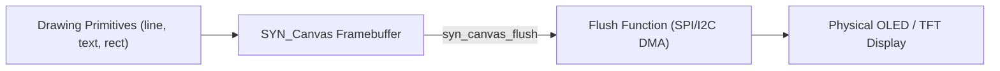

# Display & UI Modules

SyntropicOS provides hardware-independent framebuffer drawing (`syn_canvas`), 2D graphics primitives (`syn_gfx`), and a zero-allocation immediate-mode GUI engine (`syn_imgui`).

---

## 1. Framebuffer Display Canvas (`display/syn_canvas.h`)

The `syn_canvas` driver provides a hardware-agnostic framebuffer supporting both **1bpp (Monochrome OLED)** and **16bpp (RGB565 TFT)** displays.

### Architecture Data Flow



### Complete Code Example (SSD1306 Mono OLED)

```c
#include <stdio.h>
#include <syntropic/display/syn_canvas.h>

// Monochrome OLED (128×64 pixels, 1bpp = 1024 bytes)
static uint8_t framebuf[128 * 64 / 8];
static SYN_Canvas canvas;

// Flush callback: sends raw framebuffer bytes to display driver over I2C/SPI
static void oled_flush_callback(const uint8_t *buf, size_t len, void *ctx) {
    (void)ctx;
    // Send 1024-byte framebuffer via I2C/SPI DMA
    SSD1306_Transmit_Buffer(buf, len);
}

void display_setup(void) {
    // Initialize canvas: 128px width, 64px height, 1bpp monochrome format
    syn_canvas_init(&canvas, framebuf, 128, 64, 1, oled_flush_callback, NULL);
}

void render_dashboard(int temperature, int battery_pct) {
    char str[32];

    // Clear previous frame
    syn_canvas_clear(&canvas);

    // Draw header text using built-in 5x7 font (color 1 = white on 1bpp)
    syn_canvas_text(&canvas, 0, 0, "SyntropicOS Dashboard", 1);

    // Draw horizontal dividing line
    syn_canvas_line(&canvas, 0, 10, 127, 10, 1);

    // Draw metric labels
    snprintf(str, sizeof(str), "Temp: %d C", temperature);
    syn_canvas_text(&canvas, 0, 20, str, 1);

    snprintf(str, sizeof(str), "Batt: %d%%", battery_pct);
    syn_canvas_text(&canvas, 0, 32, str, 1);

    // Draw battery level progress bar outline & fill
    syn_canvas_rect(&canvas, 70, 32, 50, 8, 1); // Outline
    syn_canvas_rect_fill(&canvas, 71, 33, (int16_t)((battery_pct * 48) / 100), 6, 1); // Fill

    // Push framebuffer to hardware
    syn_canvas_flush(&canvas);
}
```

---

## 2. Immediate-Mode GUI (`ui/syn_imgui.h`)

The `syn_imgui` module provides a zero-allocation Immediate-Mode GUI framework. Widgets are drawn and input-tested in a single pass each frame without maintaining complex DOM trees or allocating dynamic heap memory.

### Features
- Widgets: Buttons, Sliders, Checkboxes, Progress Bars, Gauges, Real-time Graphs.
- Navigation: Rotary Encoder step navigation, Button clicks, or Touchscreen X/Y coordinates.

### Complete IMGUI Menu Example

```c
#include <syntropic/display/syn_canvas.h>
#include <syntropic/ui/syn_imgui.h>

static SYN_IMGUI_Context ui;
static bool heater_enabled = false;
static int32_t target_temp = 25;

void gui_setup(void) {
    syn_imgui_init(&ui);
}

void render_gui(SYN_Canvas *canvas, bool btn_select, bool btn_back, int32_t enc_delta) {
    syn_canvas_clear(canvas);
    syn_imgui_begin(&ui, canvas, btn_select, btn_back, enc_delta, false, 0, 0);

    syn_imgui_label(&ui, "Temperature Control", 10, 5);

    // Interactive Checkbox widget
    if (syn_imgui_checkbox(&ui, "Enable Heater", &heater_enabled, 10, 18, 108, 12)) {
        // Toggle callback logic
    }

    // Interactive Slider widget
    if (heater_enabled) {
        syn_imgui_slider(&ui, "Set Temp", &target_temp, 15, 40, 10, 36, 108, 12);
    }

    syn_imgui_end(&ui);
    syn_canvas_flush(canvas);
}
```

### Advanced UI Widgets

#### Virtual PIN Keypad (`syn_imgui_numpad`)

Renders a 4x3 keypad grid (`1-9`, `0`, `C` Clear, `OK` Confirm) supporting touch taps and rotary encoder navigation.

```c
static char pin_code[8] = "";

void render_pin_screen(SYN_IMGUI_Context *ctx) {
    // Render 4x3 PIN entry numpad with '*' digit masking
    int status = syn_imgui_numpad(ctx, pin_code, sizeof(pin_code), true, 0, 0, 120, 60);

    if (status == 1) {
        // OK pressed: validate passcode
        if (strcmp(pin_code, "1234") == 0) {
            syn_imgui_toast(ctx, "Access Granted", 2000, current_ms, start_ms);
        } else {
            syn_imgui_toast(ctx, "Invalid PIN", 2000, current_ms, start_ms);
            pin_code[0] = '\0'; // reset
        }
    } else if (status == -1) {
        // Clear/Back pressed on empty buffer: exit screen
        navigate_back();
    }
}
```

#### Transient Toast Banner (`syn_imgui_toast`)

Renders a floating notification overlay banner at the top of the display that auto-dismisses after `duration_ms`.

```c
// Displays a 2-second status notification overlay
syn_imgui_toast(ctx, "Settings Saved!", 2000, current_tick_ms, toast_start_ms);
```

---

## 3. Character LCD & OLED Direct Drivers (`display/syn_charlcd.h` & `display/syn_oled.h`)

Supports HD44780 16x2 / 20x4 Character LCD displays (GPIO 4-bit / I2C backpack) and SSD1306 / SH1106 monochrome OLED direct command initialization.

```c
#include <syntropic/display/syn_charlcd.h>

static SYN_CharLCD lcd;

void charlcd_demo(SYN_GPIO_Pin scl_pin, SYN_GPIO_Pin sda_pin) {
    syn_charlcd_init_i2c(&lcd, scl_pin, sda_pin, 0x27, 16, 2);
    syn_charlcd_set_cursor(&lcd, 0, 0);
    syn_charlcd_print(&lcd, "SyntropicOS");
}
```

---

## 4. 7-Segment LED Multiplex Driver (`display/syn_seg7.h`)

Multiplexed 7-segment digital display driver supporting decimal integers, floating-point rendering, and custom hexadecimal patterns.

```c
#include <syntropic/display/syn_seg7.h>

static SYN_Seg7 seg;

void seg7_demo(const SYN_GPIO_Pin seg_pins[8], const SYN_GPIO_Pin digit_pins[4]) {
    syn_seg7_init(&seg, seg_pins, digit_pins, 4, SYN_SEG7_COMMON_CATHODE);
    // Render float number 12.34 across 4 digits
    syn_seg7_print_float(&seg, 12.34f, 2);
    syn_seg7_scan(&seg); // Call periodically to multiplex digits
}
```

