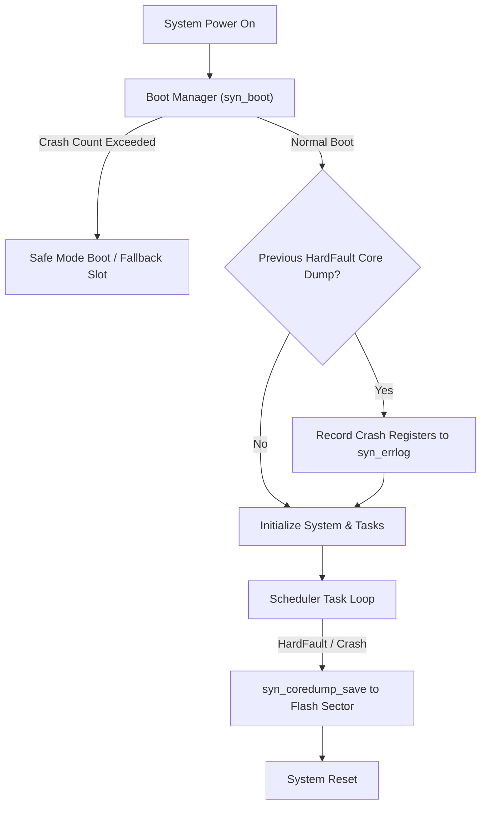

# System Architecture & Recovery Modules

SyntropicOS provides production-grade system resilience services, including crash-loop boot management, fault-recording core dumps, transport-agnostic OTA firmware updates, and persistent error registries.

---

## Architecture Resilience Map



---

## 1. Boot Manager & Safe-Mode (`system/syn_boot.h`)

The `syn_boot` module tracks continuous boot cycles and consecutive unconfirmed boots across resets. If the system resets repeatedly without marking a boot healthy, the boot manager enters **Safe Mode** to allow firmware recovery.

### Features
- Configurable consecutive failed-boot threshold (`safe_threshold`) persisted via `SYN_ParamStore`.
- Optional boot event recording to `syn_errlog` (`syn_boot_set_errlog()`, `syn_boot_log_events()`).
- Safe mode fallback flag query (`syn_boot_is_safe_mode()`).

### Code Example

```c
#include <syntropic/system/syn_boot.h>

static SYN_Boot boot;
static SYN_ParamStore boot_store;

void app_boot_check(void) {
    // Persist boot state across 2 flash sectors at 0x08030000; enter safe mode after 3 failures
    syn_param_init(&boot_store, 0x08030000, 2, sizeof(SYN_BootData));
    syn_boot_init(&boot, &boot_store, 3);

    if (syn_boot_is_safe_mode(&boot)) {
        printf("WARNING: Crash loop detected! Booting into SAFE MODE...\n");
        // Start minimal recovery task (e.g., Serial CLI or OTA UART update)
    } else {
        printf("Normal boot sequence proceeding.\n");
    }
}

void app_main_ready(void) {
    // Call once system initialization completes to reset fail_count
    syn_boot_mark_healthy(&boot);
}
```

---

## 2. Core Dump & Hardware Fault Recovery (`system/syn_coredump.h` & `system/syn_fault.h`)

When a hardware fault (e.g. ARM Cortex-M HardFault, BusFault, or Memory Management Fault) occurs, `syn_coredump` captures the CPU registers (`PC`, `LR`, `SP`, `PSR`) and a stack snapshot, persisting them to flash before resetting.

### Features
- Zero-heap register and stack capture inside fault ISR handler.
- Reads back register snapshot on next boot for post-mortem diagnostics.

### Code Example

```c
#include <syntropic/system/syn_coredump.h>
#include <syntropic/system/syn_fault.h>

void check_previous_crash(void) {
    SYN_CoreDump dump;

    // Read and verify previous crash dump from flash
    if (syn_coredump_read(&dump)) {
        printf("CRASH DETECTED on last boot!\n");
        printf("  Fault PC:  0x%08X\n", (unsigned int)dump.regs.pc);
        printf("  Fault LR:  0x%08X\n", (unsigned int)dump.regs.lr);
        printf("  Uptime:    %lu ms\n", (unsigned long)dump.uptime_ms);

        // Clear core dump after reading
        syn_coredump_clear();
    }
}

// Called from Cortex-M HardFault_Handler assembly stub with stacked exception frame pointer
void hardfault_capture_frame(const uint32_t *sp) {
    SYN_FaultContext ctx = {
        .r0 = sp[0],
        .r1 = sp[1],
        .r2 = sp[2],
        .r3 = sp[3],
        .r12 = sp[4],
        .lr = sp[5],
        .pc = sp[6],
        .xpsr = sp[7],
        .sp = (uint32_t)(uintptr_t)sp,
    };
    syn_fault_capture(&ctx);
    syn_coredump_save(&ctx);

    syn_port_system_reset();
}
```

---

## 3. Persistent Error Log (`system/syn_errlog.h`)

The `syn_errlog` module maintains a circular error registry storing application error code, severity, boot count, timestamp, and context value.

```c
#include <syntropic/system/syn_errlog.h>

#define ERR_TIMEOUT 0x1001U

static SYN_ErrLog errlog;
static SYN_ErrEntry log_buffer[16];

void app_setup_errlog(uint32_t current_boot_count) {
    syn_errlog_init(&errlog, log_buffer, 16, current_boot_count);

    // Log an error event
    syn_errlog_record(&errlog, ERR_TIMEOUT, SYN_ERR_ERROR, 0x0042);
}
```

---

## 4. Transport-Agnostic Firmware Update (`system/syn_fwupdate.h`)

Provides streaming, block-by-block OTA firmware image flashing with running CRC-32 verification and optional HMAC-SHA256, Ed25519, or AES-GCM authentication.

```c
#include <syntropic/system/syn_fwupdate.h>

#define SLOT_B_ADDR 0x08040000U
#define SLOT_B_SIZE 0x00020000U

static uint8_t page_buf[256];
static SYN_FwUpdate fw;

void ota_start(void) {
    syn_fwupdate_begin(&fw, SLOT_B_ADDR, SLOT_B_SIZE, page_buf, sizeof(page_buf));
}

void on_ota_chunk_received(const uint8_t *chunk, size_t len) {
    // Stream incoming firmware chunks over UART, Wi-Fi, BLE, or CAN
    syn_fwupdate_write(&fw, chunk, len);
}

SYN_Status ota_complete(uint32_t expected_crc, uint32_t new_version) {
    return syn_fwupdate_finish(&fw, expected_crc, new_version);
}
```
